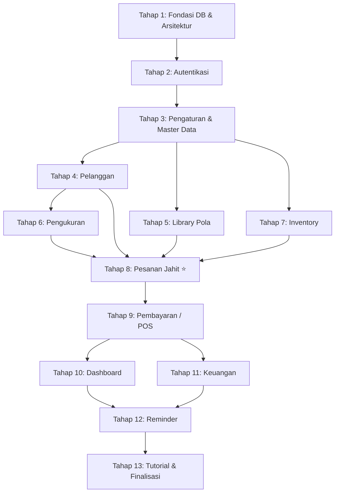

# Tailor Management System — Rencana Pengembangan Web

> Prinsip utama: **Backend (Service Layer + REST API) dibangun duluan setiap modul**, baru kemudian Web Frontend (Blade/Livewire) memanfaatkan Service yang sama. Dengan pola ini, saat nanti mobile dikembangkan, API sudah siap pakai tanpa perubahan apapun.

---

## Arsitektur Pemisahan Kode

Setiap modul akan mengikuti pola ini:

```
app/
├── Services/              ← Business logic murni (dipakai Web + API)
│   ├── PelangganService.php
│   ├── PesananService.php
│   └── ...
│
├── Http/
│   ├── Controllers/       ← Web Controllers (return Blade view)
│   │   ├── PelangganController.php
│   │   └── ...
│   │
│   └── Controllers/Api/   ← API Controllers (return JSON)
│       ├── PelangganController.php
│       └── ...
│
├── Http/Resources/        ← Eloquent API Resources (format JSON)
│   ├── PelangganResource.php
│   └── ...
│
├── Http/Requests/         ← Form Requests (validasi, shared web+API)
│   ├── StorePelangganRequest.php
│   └── ...
│
└── Models/                ← Eloquent Models + Relationships
    ├── Pelanggan.php
    └── ...
```

```
routes/
├── web.php                ← Route untuk Blade/Livewire (session auth)
└── api.php                ← Route untuk REST API (Sanctum token auth)
```

> [!IMPORTANT]
> **Web Controller** dan **API Controller** TIDAK boleh mengandung business logic. Keduanya hanya memanggil **Service** yang sama. Ini menjamin web dan mobile selalu konsisten.

---

## Tahap 1 — Fondasi Database & Arsitektur

### 1A. Migrations (seluruh tabel sekaligus)

Urutan migrasi berdasarkan dependency:

| # | Tabel | Keterangan |
|---|-------|------------|
| 1 | `users` | Sudah ada (bawaan Laravel) |
| 2 | `pelanggan` | Nama, HP, alamat, catatan |
| 3 | `jenis_jasa` | Nama jasa, deskripsi, is_active |
| 4 | `template_tahapan` | FK → jenis_jasa, nama tahapan, urutan |
| 5 | `kategori_pola` | Nama kategori (Kemeja, Celana, dll) |
| 6 | `jenis_pakaian` | FK → kategori_pola, nama jenis |
| 7 | `pola_detail` | FK → jenis_pakaian, size, ukuran-ukuran, foto, file, catatan |
| 8 | `pengukuran` | FK → pelanggan, data ukuran tubuh, tanggal ukur |
| 9 | `pesanan` | FK → pelanggan, nomor pesanan, tanggal, deadline, catatan |
| 10 | `item_pesanan` | FK → pesanan, jenis_jasa, pola_detail?, pengukuran?, harga, deadline, catatan |
| 11 | `progress_item` | FK → item_pesanan, nama tahapan, urutan, is_completed, completed_at |
| 12 | `pembayaran` | FK → pesanan, jumlah, metode, catatan, tanggal |
| 13 | `kategori_bahan` | Nama kategori bahan |
| 14 | `bahan` | FK → kategori_bahan, nama, satuan, stok, stok_minimum |
| 15 | `pemakaian_bahan` | FK → item_pesanan, FK → bahan, jumlah, catatan |
| 16 | `riwayat_stok` | FK → bahan, jenis (masuk/keluar), jumlah, catatan |
| 17 | `peralatan` | Nama, kondisi, tanggal beli, catatan |
| 18 | `kategori_pengeluaran` | Nama kategori |
| 19 | `pengeluaran` | FK → kategori_pengeluaran, nominal, catatan, tanggal |
| 20 | `pengaturan` | Key-value store untuk setting aplikasi |
| 21 | `foto_referensi` | Polymorphic (item_pesanan / pola_detail), path file |

### 1B. MySQL Advanced Features

| Fitur | Implementasi |
|-------|-------------|
| **Trigger** | `AFTER INSERT ON pemakaian_bahan` → kurangi stok bahan + insert riwayat_stok |
| **Trigger** | `AFTER UPDATE ON bahan` → insert riwayat_stok otomatis |
| **Stored Function** | `fn_sisa_pembayaran(pesanan_id)` → hitung total harga - total dibayar |
| **Stored Function** | `fn_status_pembayaran(pesanan_id)` → return 'Belum Bayar' / 'DP' / 'Lunas' |
| **Stored Procedure** | `sp_buat_pesanan(...)` → insert pesanan + item + copy template tahapan → progress_item |
| **Transaction** | Dipakai di Service layer (pembuatan pesanan + pemakaian bahan = atomic) |

### 1C. Models, Factories, Seeders

- Buat semua Model dengan relasi lengkap
- Buat Factory untuk setiap model (data dummy)
- Buat Seeder: data jenis jasa default + template tahapan, kategori pola, kategori bahan

### Deliverable Tahap 1
- [x] Seluruh migration berjalan (`php artisan migrate`)
- [x] Trigger, Function, Procedure aktif di MySQL
- [x] Semua Model + relasi terdefinisi
- [x] `php artisan db:seed` mengisi data awal
- [x] Test: relasi dan factory berjalan benar

---

## Tahap 2 — Autentikasi

### Backend
- Login/logout session (web)
- Login API → generate Sanctum token (untuk mobile nanti)
- Register (opsional, bisa hanya seed user pertama)
- Middleware auth untuk web route
- Middleware `auth:sanctum` untuk API route

### Frontend
- Halaman login (Blade + Tailwind)
- Redirect setelah login ke Dashboard

### Deliverable Tahap 2
- [x] Web: login → session → redirect dashboard
- [x] API: `POST /api/login` → return token
- [x] API: `POST /api/logout` → revoke token
- [x] Middleware terpasang di route group

---

## Tahap 3 — Pengaturan & Master Data

> Modul ini dibangun lebih awal karena menjadi **dependensi** modul lain (Pesanan butuh Jenis Jasa, Pola butuh Kategori, dll).

### Backend (Service + API)
- **Jenis Jasa**: CRUD + kelola Template Tahapan per jasa
- **Kategori Pola**: CRUD
- **Kategori Bahan**: CRUD
- **Kategori Pengeluaran**: CRUD
- **Profil Usaha**: update nama usaha, alamat, logo, no HP
- **Pengaturan Invoice**: format nomor pesanan, template invoice

### Frontend (Blade/Livewire)
- Halaman Pengaturan dengan tab/sidebar:
  - Jenis Jasa (+ inline editor template tahapan)
  - Kategori Pola
  - Kategori Bahan
  - Kategori Pengeluaran
  - Profil Usaha
  - Pengaturan Invoice

### Deliverable Tahap 3
- [x] CRUD Jenis Jasa + Template Tahapan (backend + frontend)
- [x] CRUD semua kategori master
- [x] Profil Usaha tersimpan
- [x] API endpoint tersedia untuk semua master data
- [x] Test: CRUD master data

---

## Tahap 4 — Modul Pelanggan

### Backend (Service + API)
- `PelangganService`: create, update, delete, list (search + pagination), show detail
- Detail pelanggan include: riwayat pesanan, total transaksi (computed)
- `PelangganResource` untuk format JSON API
- `StorePelangganRequest` / `UpdatePelangganRequest` validasi

### API Endpoints
```
GET    /api/pelanggan              → list + search + paginate
POST   /api/pelanggan              → create
GET    /api/pelanggan/{id}         → detail + riwayat pesanan + total transaksi
PUT    /api/pelanggan/{id}         → update
DELETE /api/pelanggan/{id}         → delete
```

### Frontend (Blade/Livewire)
- Halaman daftar pelanggan (search, pagination)
- Modal/halaman tambah pelanggan
- Halaman detail pelanggan (info + riwayat pesanan + total transaksi)
- Edit & hapus pelanggan

### Deliverable Tahap 4
- [x] CRUD Pelanggan (backend + API + frontend)
- [x] Search & pagination berfungsi
- [x] Detail menampilkan riwayat pesanan & total transaksi
- [x] Test: feature test CRUD pelanggan

---

## Tahap 5 — Library Pola

### Backend (Service + API)
- `PolaService`: CRUD kategori pola, jenis pakaian, pola detail (per size)
- Upload foto pola + file pola (storage/app/public)
- Relasi: Kategori Pola → Jenis Pakaian → Pola Detail (per size)

### API Endpoints
```
GET    /api/pola/kategori                     → list kategori
GET    /api/pola/kategori/{id}/jenis-pakaian  → list jenis pakaian per kategori
GET    /api/pola/jenis-pakaian/{id}/detail    → list pola detail (per size)
POST   /api/pola/detail                       → create pola detail
PUT    /api/pola/detail/{id}                  → update
DELETE /api/pola/detail/{id}                  → delete
```

### Frontend (Blade/Livewire)
- Navigasi: Kategori → Jenis Pakaian → Pilih Size → Detail Pola
- Form tambah/edit pola detail (ukuran-ukuran, foto, file, catatan)
- Upload foto dan file pola
- Preview foto pola

### Deliverable Tahap 5
- [x] Navigasi hierarki pola (kategori → jenis → size → detail)
- [x] Upload foto/file pola berfungsi
- [x] API endpoint lengkap
- [x] Test: CRUD pola detail

---

## Tahap 6 — Pengukuran Pelanggan

### Backend (Service + API)
- `PengukuranService`: create, list per pelanggan, show, update, get pengukuran terakhir
- Data: lingkar dada, pinggang, lebar bahu, panjang lengan, dll (flexible JSON atau kolom tetap)
- Relasi: Pelanggan → Pengukuran (1:N, ada tanggal ukur)

### API Endpoints
```
GET    /api/pelanggan/{id}/pengukuran         → list pengukuran pelanggan
GET    /api/pelanggan/{id}/pengukuran/latest   → pengukuran terakhir
POST   /api/pengukuran                         → create baru
PUT    /api/pengukuran/{id}                    → update
DELETE /api/pengukuran/{id}                    → delete
```

### Frontend (Blade/Livewire)
- Di halaman detail pelanggan: tab/section pengukuran
- Form input pengukuran baru
- Opsi "gunakan pengukuran terakhir" (pre-fill form)
- Riwayat pengukuran per pelanggan

### Deliverable Tahap 6
- [x] Input pengukuran baru + gunakan terakhir
- [x] Riwayat pengukuran per pelanggan
- [x] API endpoint lengkap
- [x] Test: CRUD pengukuran

---

## Tahap 7 — Inventory (Bahan & Peralatan)

### Backend (Service + API)
- `InventoryService`:
  - **Bahan**: CRUD, update stok (masuk), riwayat stok, alert stok menipis
  - **Peralatan**: CRUD (tanpa stok)
- MySQL Trigger: auto kurangi stok saat pemakaian_bahan di-insert
- MySQL Trigger: auto catat riwayat_stok saat stok berubah

### API Endpoints
```
GET    /api/bahan                  → list + filter stok menipis
POST   /api/bahan                  → create
PUT    /api/bahan/{id}             → update
POST   /api/bahan/{id}/stok-masuk  → tambah stok
GET    /api/bahan/{id}/riwayat     → riwayat stok

GET    /api/peralatan              → list
POST   /api/peralatan              → create
PUT    /api/peralatan/{id}         → update
DELETE /api/peralatan/{id}         → delete
```

### Frontend (Blade/Livewire)
- Tab Bahan: daftar bahan + indikator stok menipis, form stok masuk
- Tab Peralatan: daftar peralatan + form CRUD
- Riwayat stok per bahan

### Deliverable Tahap 7
- [x] CRUD Bahan & Peralatan
- [x] Stok masuk & riwayat stok berfungsi
- [x] MySQL Trigger aktif (auto kurangi stok, auto riwayat)
- [x] Alert stok menipis
- [x] Test: stok masuk/keluar, trigger berjalan

---

## Tahap 8 — Pesanan Jahit ⭐ (Modul Utama)

> Ini modul paling kompleks. Dibangun setelah semua dependensinya siap (pelanggan, jenis jasa, pola, pengukuran, bahan).

### Backend (Service + API)
- `PesananService`:
  - Buat pesanan baru (header + items + copy template tahapan → progress_item)
  - Menggunakan **Stored Procedure** `sp_buat_pesanan` + **Transaction**
  - Update pesanan (header)
  - Tambah/hapus item pesanan
  - Pemakaian bahan per item (trigger auto potong stok)
  - Upload foto referensi per item
  - List pesanan (filter: status, pelanggan, deadline)
  - Detail pesanan lengkap (header + items + progress + pembayaran)

- `ProgressService`:
  - Update progress item (maju/mundur tahapan)
  - Get current stage per item

- **Stored Function**: `fn_sisa_pembayaran`, `fn_status_pembayaran` digunakan saat query

### API Endpoints
```
GET    /api/pesanan                         → list + filter + paginate
POST   /api/pesanan                         → create (header + items)
GET    /api/pesanan/{id}                    → detail lengkap
PUT    /api/pesanan/{id}                    → update header
DELETE /api/pesanan/{id}                    → cancel/delete

POST   /api/pesanan/{id}/item               → tambah item
PUT    /api/pesanan/item/{id}               → update item
DELETE /api/pesanan/item/{id}               → hapus item

PUT    /api/pesanan/item/{id}/progress      → update progress (maju/mundur)
POST   /api/pesanan/item/{id}/bahan         → catat pemakaian bahan
POST   /api/pesanan/item/{id}/foto          → upload foto referensi
```

### Frontend (Blade/Livewire)
- Daftar pesanan (tabel + filter status/deadline/pelanggan)
- **Form pembuatan pesanan** (multi-step atau single page):
  1. Pilih pelanggan (autocomplete)
  2. Tambah item (jenis jasa, pola opsional, pengukuran opsional, harga, deadline)
  3. Set deadline keseluruhan
  4. Catatan
  5. Pembayaran DP opsional
  6. Submit
- **Detail pesanan**:
  - Info header
  - Daftar item + progress masing-masing (visual step indicator)
  - Tombol update progress per item
  - Riwayat pembayaran
  - Pemakaian bahan
  - Foto referensi
- **Edit pesanan**: edit header, tambah/hapus item

### Deliverable Tahap 8
- [x] Pembuatan pesanan berjalan atomic untuk header + item pertama + progress (via `sp_buat_pesanan`); item tambahan & DP dicatat setelahnya dalam transaksi terpisah dengan kompensasi (hapus pesanan bila gagal)
- [x] Progress per item bisa dimajukan/dimundurkan
- [x] Pemakaian bahan terhubung ke stok (trigger aktif)
- [x] Filter & search pesanan
- [x] Stored Procedure + Transaction berfungsi
- [x] Test: create pesanan, update progress, pemakaian bahan

---

## Tahap 9 — Pembayaran / POS Jasa

### Backend (Service + API)
- `PembayaranService`:
  - Input pembayaran (multiple partial payment)
  - Hitung sisa (via Stored Function `fn_sisa_pembayaran`)
  - Status otomatis (via Stored Function `fn_status_pembayaran`)
  - Riwayat pembayaran per pesanan
  - Generate invoice (PDF)

### API Endpoints
```
POST   /api/pesanan/{id}/pembayaran         → input pembayaran
GET    /api/pesanan/{id}/pembayaran          → riwayat pembayaran
GET    /api/pesanan/{id}/invoice             → generate/view invoice
DELETE /api/pembayaran/{id}                  → batalkan pembayaran
```

### Frontend (Blade/Livewire)
- Di detail pesanan: section pembayaran
  - Total harga (sum item), total dibayar, sisa
  - Tombol "Input Pembayaran" (modal: jumlah, metode, catatan)
  - Riwayat pembayaran
  - Status: Belum Bayar / DP / Lunas (auto-computed)
- Cetak/download invoice (PDF)
- Flow "Pesanan Selesai → Cek Sisa → Bayar → Diambil"

### Deliverable Tahap 9
- [x] Pembayaran bertahap (multiple partial payment)
- [x] Status pembayaran dihitung otomatis (Stored Function)
- [x] Invoice PDF bisa di-generate
- [x] Test: pembayaran bertahap, status otomatis

---

## Tahap 10 — Dashboard

> Dashboard dibangun belakangan karena butuh data dari semua modul lain.

### Backend (Service + API)
- `DashboardService`:
  - Pesanan aktif (count + list)
  - Pesanan mendekati deadline (H-3)
  - Pesanan terlambat
  - Pembayaran belum lunas (count + total)
  - Pendapatan bulan ini
  - Pengeluaran bulan ini
  - Stok bahan menipis

### API Endpoints
```
GET    /api/dashboard/summary               → semua metric ringkasan
GET    /api/dashboard/pesanan-aktif          → detail pesanan aktif
GET    /api/dashboard/pesanan-terlambat      → detail pesanan terlambat
GET    /api/dashboard/stok-menipis           → bahan yang menipis
```

### Frontend (Blade/Livewire)
- Card widget: pesanan aktif, mendekati deadline, terlambat
- Card widget: pembayaran belum lunas
- Card widget: pendapatan vs pengeluaran bulan ini
- Card widget: stok bahan menipis
- Shortcut link ke modul terkait
- Auto-refresh (diimplementasikan via AJAX + Alpine, mengambil partial `dashboard._widget`; Livewire belum dipakai)

### Deliverable Tahap 10
- [x] Semua widget dashboard menampilkan data real
- [x] Shortcut navigasi berfungsi
- [x] API endpoint dashboard tersedia
- [x] Test: dashboard service

---

## Tahap 11 — Keuangan

### Backend (Service + API)
- `KeuanganService`:
  - Pendapatan: aggregat dari tabel pembayaran (auto, tidak manual)
  - Pengeluaran: CRUD manual
  - Ringkasan: pendapatan - pengeluaran = selisih (per periode)

### API Endpoints
```
GET    /api/keuangan/ringkasan?dari=&sampai=  → pendapatan, pengeluaran, selisih
GET    /api/keuangan/pendapatan               → list pembayaran masuk
GET    /api/pengeluaran                        → list pengeluaran
POST   /api/pengeluaran                        → create
PUT    /api/pengeluaran/{id}                   → update
DELETE /api/pengeluaran/{id}                   → delete
```

### Frontend (Blade/Livewire)
- Ringkasan: Pendapatan - Pengeluaran = Selisih (filter periode)
- Tab Pendapatan: list otomatis dari pembayaran
- Tab Pengeluaran: CRUD manual (kategori, nominal, catatan, tanggal)

### Deliverable Tahap 11
- [x] Ringkasan keuangan per periode
- [x] CRUD Pengeluaran
- [x] Pendapatan teragregat otomatis dari pembayaran
- [x] Test: ringkasan keuangan

---

## Tahap 12 — Reminder

### Backend (Service + API)
- `ReminderService`:
  - Deteksi: pesanan mendekati deadline
  - Deteksi: pesanan terlambat
  - Deteksi: pembayaran belum lunas (pesanan selesai tapi belum bayar)
  - Deteksi: pesanan siap diambil
  - Deteksi: stok bahan menipis
- Laravel Scheduler (cron): jalankan pengecekan harian

### API Endpoints
```
GET    /api/reminders                         → list reminder aktif
PUT    /api/reminders/{id}/dismiss            → dismiss/tandai sudah dibaca
```

### Frontend (Blade/Livewire)
- Notifikasi bell icon di navbar (count badge)
- Dropdown/panel reminder (diimplementasikan dengan Blade + Alpine; Livewire belum dipakai)
- Link ke pesanan/bahan terkait
- Dismiss reminder

### Deliverable Tahap 12
- [x] Scheduler mendeteksi kondisi dan membuat reminder
- [x] Notifikasi muncul di navbar
- [x] Dismiss berfungsi
- [x] Test: deteksi reminder

---

## Tahap 13 — Tutorial / Knowledge Base & Finalisasi

### Backend (Service + API)
- `TutorialService`:
  - CRUD tutorial (judul, konten, kategori, tipe: artikel/video/PDF)
  - Upload file (PDF, gambar), video sebagai embed link (YouTube)
  - Kategori tutorial

### API Endpoints
```
GET    /api/tutorial                          → list + filter kategori
POST   /api/tutorial                          → create
GET    /api/tutorial/{id}                     → detail
PUT    /api/tutorial/{id}                     → update
DELETE /api/tutorial/{id}                     → delete
```

### Frontend (Blade/Livewire)
- Grid/list tutorial per kategori
- Detail tutorial (render artikel, embed video, download PDF)
- Form tambah/edit tutorial

### Finalisasi
- [x] Review seluruh API endpoint (konsistensi response format)
- [x] Pagination konsisten di semua list endpoint
- [x] Error handling & validation message konsisten
- [ ] Storage link (`php artisan storage:link`)
- [ ] Seed data demo lengkap (ditunda: aplikasi memakai database asli; seeder demo dibuat bila dibutuhkan)
- [ ] Jalankan seluruh test suite
- [ ] Pint formatting final
- [x] README.md: cara install, setup, dan menjalankan

---

## Ringkasan Urutan Pengerjaan



> [!TIP]
> Tahap 4, 5, 6, 7 bisa dikerjakan **paralel** setelah Tahap 3 selesai, karena tidak saling bergantung. Tapi semuanya harus selesai sebelum Tahap 8 (Pesanan) dimulai.
